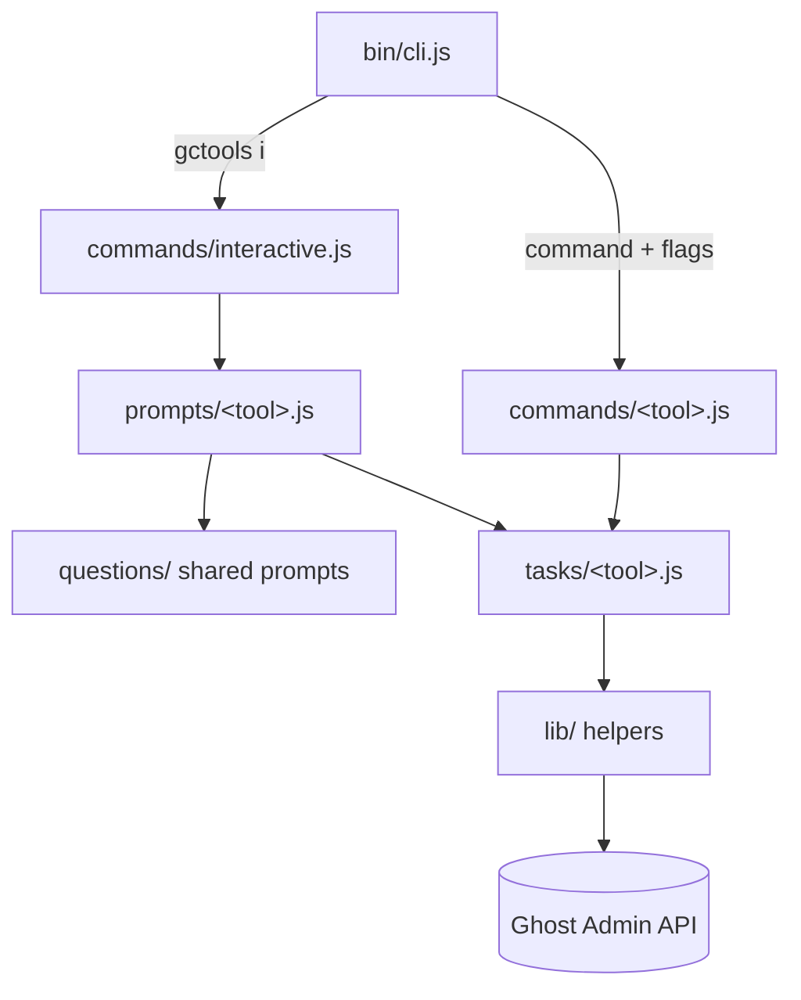

# GCTools

Command line utilities for working with Ghost content.


## Install

Requires Node.js `^26.13.0` (the current LTS line).

1. `git clone` this repo & `cd` into it as usual
2. Run `pnpm install` to install top-level dependencies.
3. To make `gctools` accessible globally, run `pnpm add -g .`
    - This needs pnpm's global bin directory to be on your `PATH`. If it isn't, run `pnpm setup` once and restart your shell
    - You need to run this after making changes to the codebase to update the global version
    - If developing the code, `pnpm dev ...` is a more suitable command


## Usage

To see all available tools, run:

```sh
gctools
```


### Interactive Mode

GCTools has an interactive mode which walks you through each tool, without needing to manually type multiple option flags.

```sh
gctools i
```

Each tool also has a traditional CLI counterpart with more options, listed in the command index below and documented in detail in [`/docs`](docs).


## Commands

Every command is documented in a per-group file under [`/docs`](docs), and `gctools <command> --help` is always authoritative.

### Tools

| Command | Description |
| --- | --- |
| [`fetch-assets`](docs/tools.md#fetch-assets) | Fetch the assets referenced in a Ghost JSON file |
| [`json-split`](docs/tools.md#json-split) | Split a large Ghost export JSON file into multiple smaller files |
| [`zip-create`](docs/tools.md#zip-create) | Create multiple zip files of a predefined maximum size from a source directory |
| [`zip-split`](docs/tools.md#zip-split) | Split a large zip file into smaller zips of a predefined maximum size |

### Content

| Command | Description |
| --- | --- |
| [`add-preview`](docs/content.md#add-preview) | Add a public preview to posts |
| [`add-tags`](docs/content.md#add-tags) | Add tags to posts and pages in Ghost |
| [`remove-tags`](docs/content.md#remove-tags) | Remove tags from posts and pages in Ghost |
| [`change-author`](docs/content.md#change-author) | Change the author of posts |
| [`add-author`](docs/content.md#add-author) | Add an author to posts |
| [`change-status`](docs/content.md#change-status) | Switch the status for posts |
| [`change-visibility-posts`](docs/content.md#change-visibility-posts) | Switch the visibility for posts from one level to another |
| [`change-visibility-pages`](docs/content.md#change-visibility-pages) | Switch the visibility for pages from one level to another |
| [`combine-tags`](docs/content.md#combine-tags) | Merge one tag into another, preserving tag position |
| [`content-stats`](docs/content.md#content-stats) | See stats on how much content your Ghost site has |
| [`delete-empty-tags`](docs/content.md#delete-empty-tags) | Delete tags in Ghost with no associated posts |
| [`delete-pages`](docs/content.md#delete-pages) | Delete pages in Ghost |
| [`delete-posts`](docs/content.md#delete-posts) | Delete posts in Ghost |
| [`delete-tags`](docs/content.md#delete-tags) | Delete tags in Ghost |
| [`find-replace`](docs/content.md#find-replace) | Find & replace text in Ghost |
| [`random-posts`](docs/content.md#random-posts) | Insert random posts into Ghost |
| [`change-tags`](docs/content.md#change-tags) | Combine tags in Ghost |
| [`post-tiers`](docs/content.md#post-tiers) | Add extra tier to post with tiers |
| [`page-to-post`](docs/content.md#page-to-post) | Change posts to pages, and pages to posts |
| [`get-posts`](docs/content.md#get-posts) | Get all posts from Ghost |
| [`set-template`](docs/content.md#set-template) | Set posts to use a specific custom template |
| [`set-featured-images`](docs/content.md#set-featured-images) | Set featured images for posts that don't have one by using the first image in the post content |
| [`set-podcast`](docs/content.md#set-podcast) | Set Facebook description for podcast posts using the first audio src URL from the post content |
| [`set-canonical-url`](docs/content.md#set-canonical-url) | Clear or rebuild the canonical_url for posts |
| [`clean-slugs`](docs/content.md#clean-slugs) | Find and remove alphanumeric IDs from post and tag slugs |
| [`inline-media`](docs/content.md#inline-media) | Download external images and re-upload them to Ghost |
| [`update-posts-from-json`](docs/content.md#update-posts-from-json) | Update Ghost posts from a Ghost export JSON file |
| [`seed-demo`](docs/content.md#seed-demo) | Seed a Ghost site with rich demo content (posts, images, tags, an about page, a style guide, and navigation) |
| [`export-comments`](docs/content.md#export-comments) | Export all comments from a Ghost site as a CSV compatible with the comment importer |
| [`keep-tags`](docs/content.md#keep-tags) | Delete every Ghost tag that is not listed in a CSV of tags to keep |

### Members

| Command | Description |
| --- | --- |
| [`add-member-comp-subscription`](docs/members.md#add-member-comp-subscription) | Add member complimentary subscription |
| [`remove-member-comp-subscription`](docs/members.md#remove-member-comp-subscription) | Remove member complimentary subscription |
| [`add-member-newsletter-subscription`](docs/members.md#add-member-newsletter-subscription) | Add member newsletter subscription |
| [`dedupe-members-csv`](docs/members.md#dedupe-members-csv) | Deduplicate members |
| [`compare-member-csv`](docs/members.md#compare-member-csv) | Compare two member CSV files and export differences |
| [`delete-labels`](docs/members.md#delete-labels) | Delete named, unused or all member labels, optionally keeping a list of labels |
| [`add-member-comp-from-csv`](docs/members.md#add-member-comp-from-csv) | Add member complimentary subscriptions from a CSV file |
| [`member-newsletter-backup`](docs/members.md#member-newsletter-backup) | Backup and restore member newsletter preferences |
| [`split-members`](docs/members.md#split-members) | Split members into two zipper-balanced halves, fetched from the Ghost API or read from a CSV |
| [`add-label-to-members`](docs/members.md#add-label-to-members) | Add a label to all members listed in a CSV file |

### Staff

| Command | Description |
| --- | --- |
| [`change-role`](docs/staff.md#change-role) | Change user roles in Ghost (requires staff token) [Ghost >= 5.2.0] |
| [`clean-staff-slugs`](docs/staff.md#clean-staff-slugs) | Find and remove Ghost ID suffixes from staff user slugs when safe |
| [`comment-notifications`](docs/staff.md#comment-notifications) | Set notification preferences for all staff users |
| [`delete-staff-users`](docs/staff.md#delete-staff-users) | Delete content-free staff users in selected roles (requires a staff access token) |
| [`update-staff-bio`](docs/staff.md#update-staff-bio) | Fill empty staff bios from a CSV file, matching users by slug |

### Beta

| Command | Description |
| --- | --- |
| [`json-clean`](docs/beta.md#json-clean) | Clean a JSON file so it only contains content |


## Develop

* `bin/cli.js` is the entry point, registering all commands
* `commands` handles the traditional CLI input
* `prompts` handles the interactive CLI input
* `questions` contains shared inquirer question builders used by prompts
* `tasks` is the tasks run by both the CLI and interactive tool
* `lib` contains shared utilities (API discovery, filters, batching)

Both entry paths converge on the same task layer:



## Tests

* `pnpm test` to run all tests
* `pnpm test:coverage` to run all tests with a coverage report and enforce the coverage thresholds
* `pnpm test:file ./test/my-file.test.js` to only run a specific file
* `pnpm lint` to check linting and formatting
* `pnpm lint:fix` to fix what can be fixed automatically
* `pnpm format` to format the code

# Copyright & License

Copyright (c) 2013-2026 Ghost Foundation - Released under the [MIT license](LICENSE).
